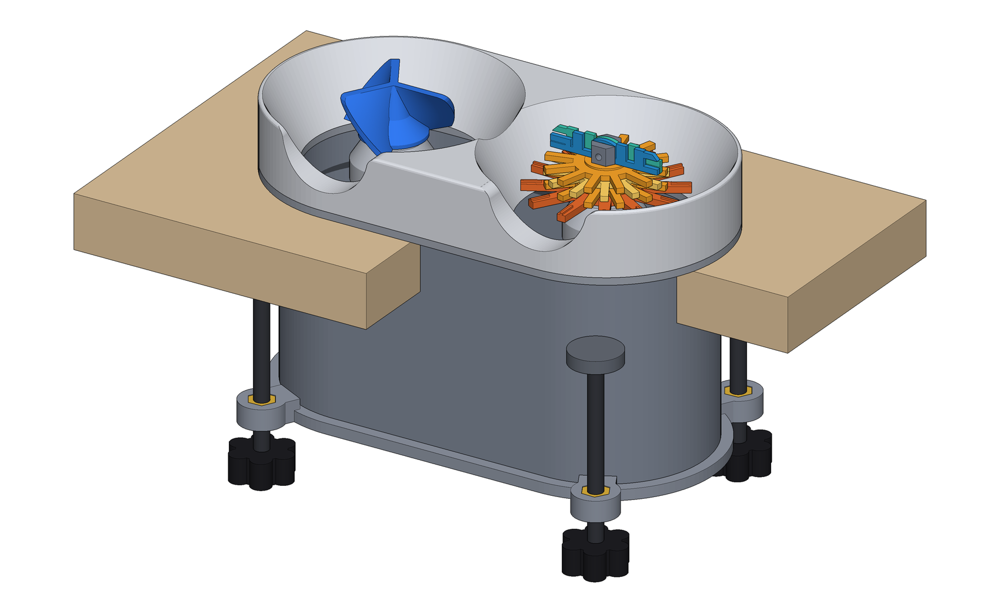
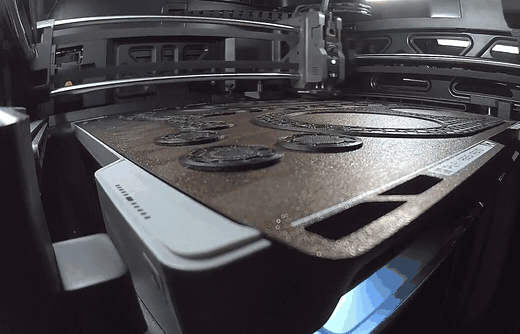
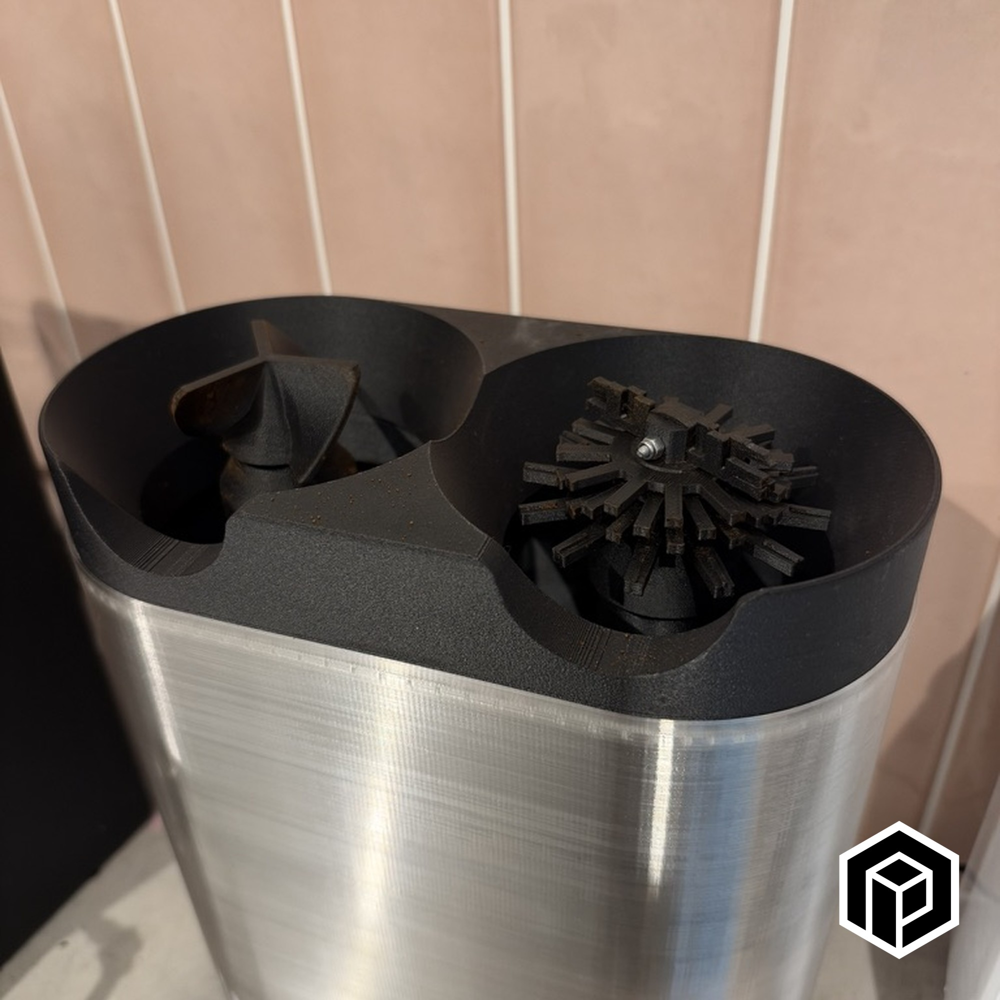
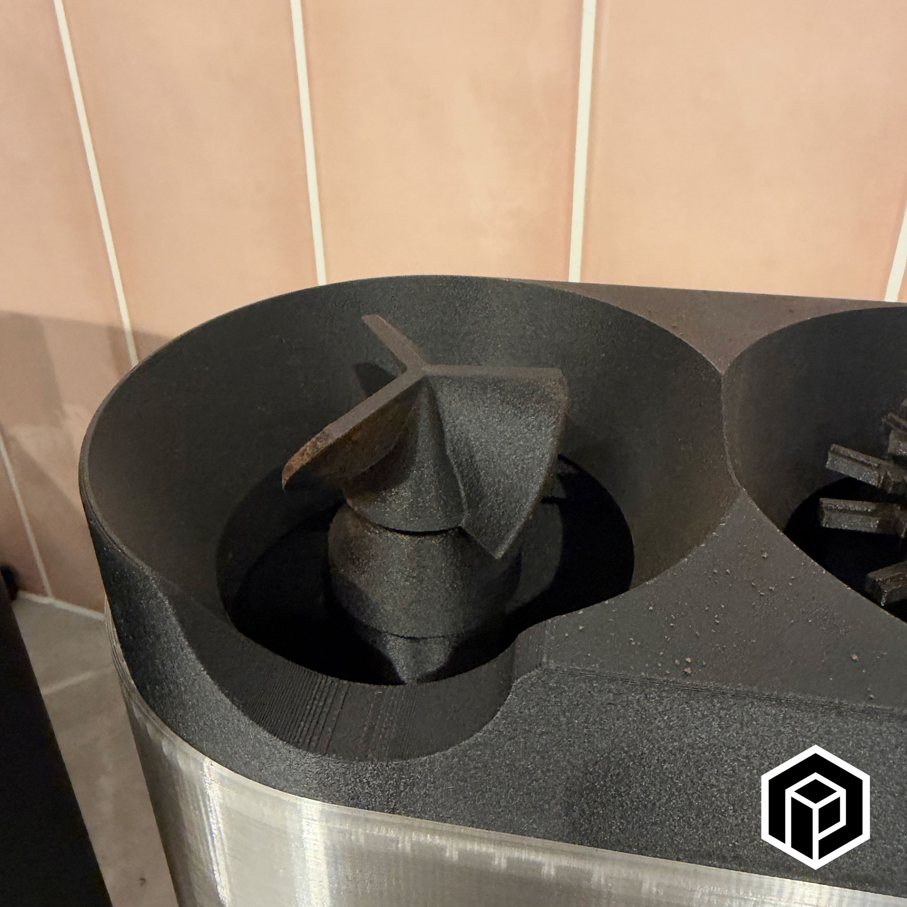
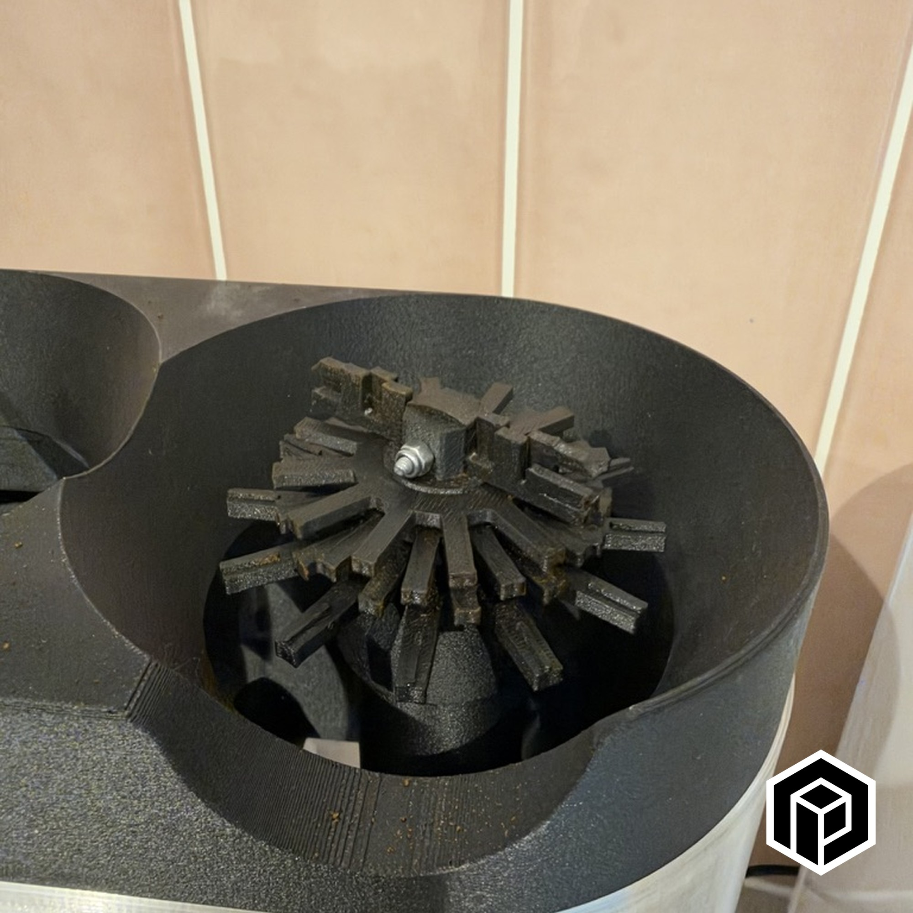
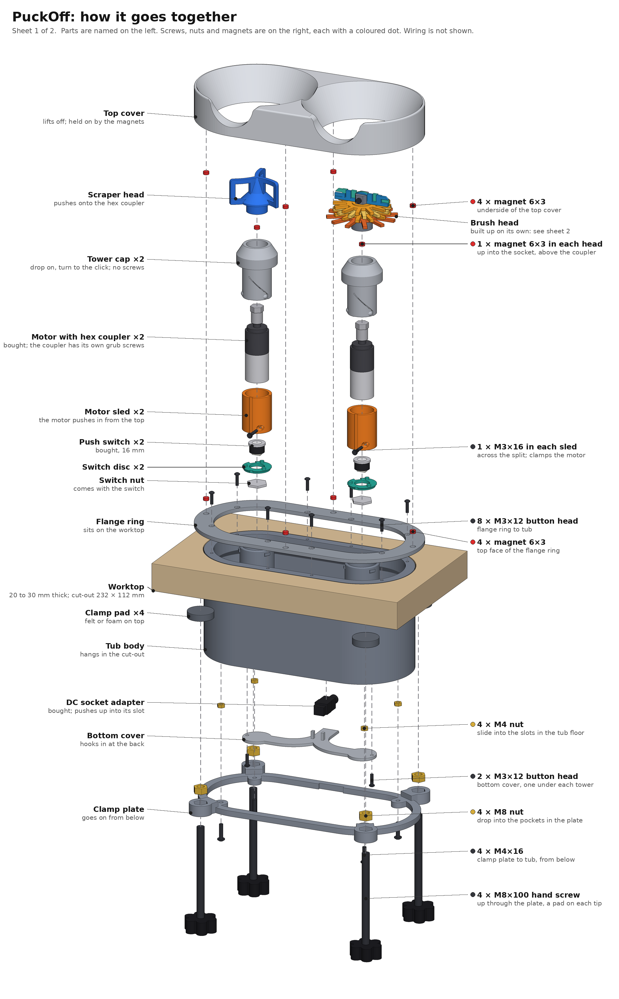
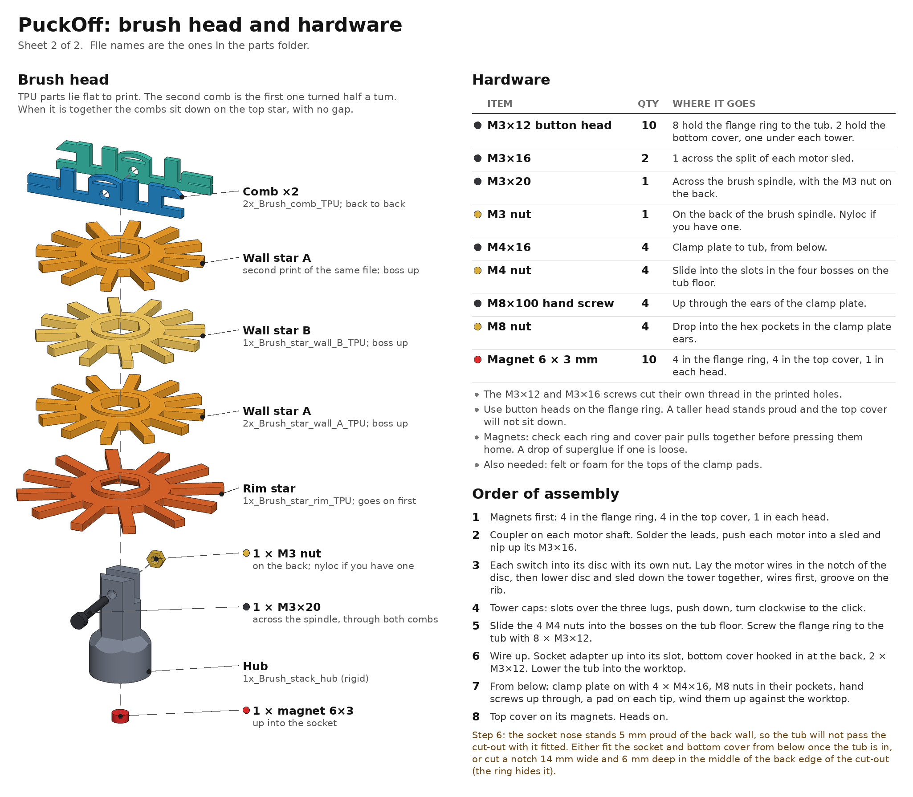
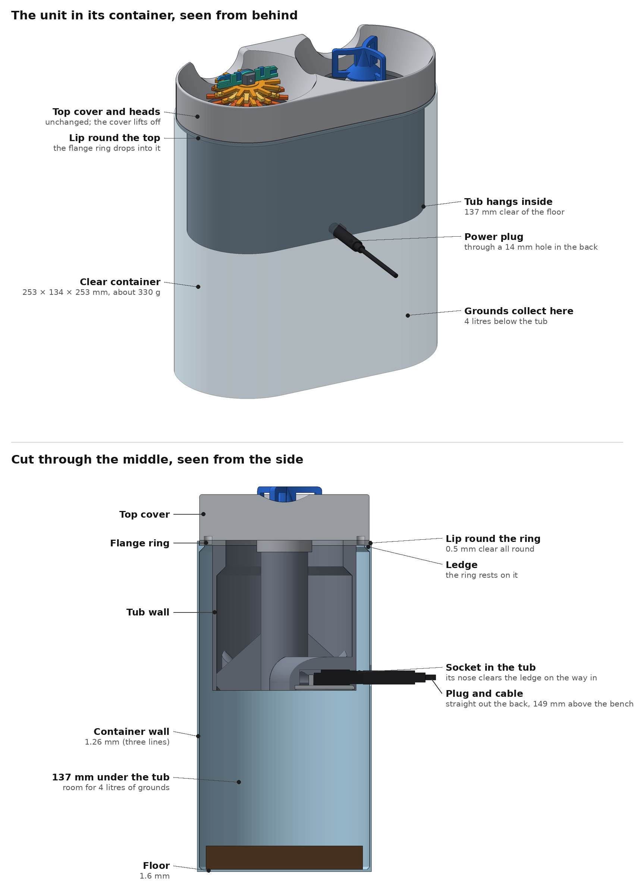
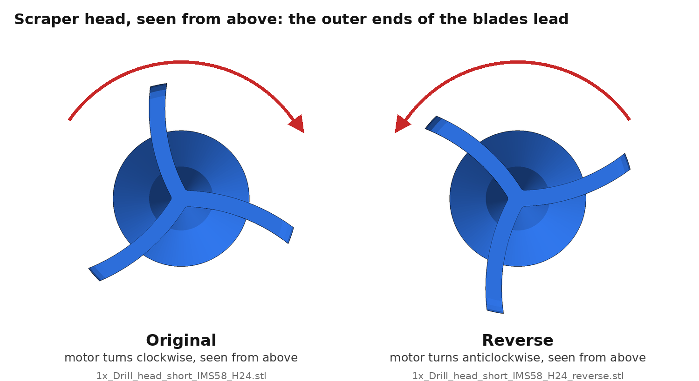
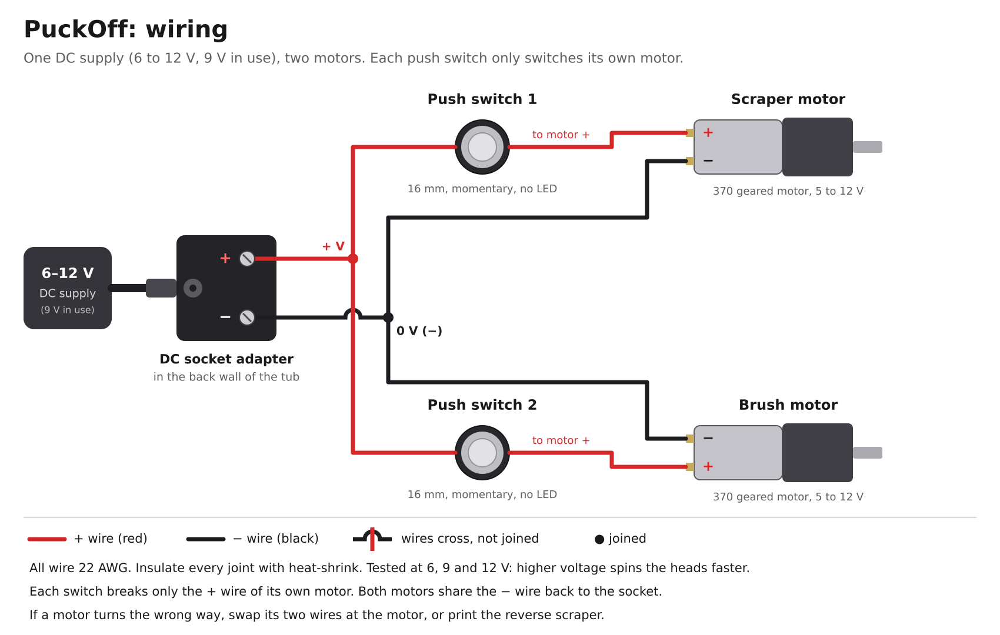

# PuckOff

A 3D-printed, two-head portafilter cleaner for espresso. Turn the portafilter upside down and press it onto a spinning head: one head scrapes out the old puck, the other brushes the basket, the corner and the rim. The heads only spin while you press, and the grounds fall through into a bin underneath.




*In use: the scraper head clears the old puck, then the brush head cleans the basket. [Full-quality video (MP4)](images/puckoff_in_use.mp4).*



*The parts printing, as a time-lapse.*

It can be fitted through a cut-out in a kitchen worktop, held by a clamp plate underneath, or stand on the bench in a printed container that catches the grounds.

A ready-to-print Bambu Lab H3C profile (8 named plates, 0.20 mm layers, tree supports) and the full parts list with the Bambu Lab store hardware are on MakerWorld: [PuckOff on MakerWorld](https://makerworld.com/en/models/3675893-puckoff-two-head-portafilter-cleaner-58-mm).

## Built

A finished v0.2 unit, with the drill head and the firmer rim star. The container in these photos is printed in clear PLA (see [`slicer`](slicer)); the printing guide now uses ABS-GF for it, like the rest of the unit.

| | | |
|---|---|---|
|  |  |  |
| On the bench in its grounds container | The drill head | The brush head |

## How it works

- Two small geared DC motors (rated 5 to 12 V) stand in towers inside a printed tub, one per head.
- Each motor sits in a sled that slides 1.5 mm down its tower onto a push switch. Pressing the portafilter onto a head pushes the motor down and switches it on; lift off and it stops.
- The heads push onto a 12 mm hex coupler on each motor shaft and are held by a magnet, so they pull straight off for cleaning.
- The **scraper head** is a short drill: three solid blades, twisted so they lean 45° at the edge, break up the puck and carry the grounds down out of the basket.
- The **brush head** is a stack of flat TPU stars and combs on a rigid spindle. The stars wipe the rim and the wall, and the combs wipe the floor and the corner.
- Tower caps lock with a twist and a click, with no screws.
- The top cover lifts off on magnets for cleaning.

Sized for a 58 mm IMS basket, 24 mm deep.

Runs on a DC supply of 6 to 12 V. It has been tested at 6 V, 9 V and 12 V and all three work; which to use is personal preference, since a higher voltage spins the heads faster. Mine runs at 9 V DC from an adjustable supply.

Printed in Bambu Lab ABS-GF for every rigid part, including the optional grounds container, and 75A TPU for the brush. Hardware comes from the Bambu Lab store; the motors, couplers, switches and power supply are listed with links in [`docs/ASSEMBLY.md`](docs/ASSEMBLY.md).

## Pictures

| | |
|---|---|
|  |  |
| Whole unit pulled apart, with every screw, nut and magnet | Brush head, hardware list and order of assembly |
|  |  |
| Bench-top version in its grounds container | Which scraper to print for your motor's direction |
|  | |
| Wiring: one DC socket, two switches, two motors | |

Both exploded sheets are also in [`docs/PuckOff_exploded_view.pdf`](docs/PuckOff_exploded_view.pdf) for printing on paper.

## What's in this repo

```
parts/
  unit/           tub, covers, tower caps, motor sleds, switch discs, clamp parts
  scraper_head/   scraper, in two hands (print one)
  brush_head/     rigid spindle and the TPU stars and combs
  container/      optional grounds container for bench-top use
images/           photos, the pictures above, the in-use video, the print time-lapse and the wiring diagram
docs/             assembly guide, printing guide, exploded view PDF
slicer/           Bambu Studio filament profile for a see-through clear PLA container
```

Every file in `parts` is one part, already turned the right way up for printing. The number at the front of the name is how many to print.

## Getting started

1. Read [`docs/PRINTING.md`](docs/PRINTING.md) for what to print, in what material and which way up.
2. Get the hardware and bought parts in [`docs/ASSEMBLY.md`](docs/ASSEMBLY.md), with links to each.
3. Wire it as in [`images/wiring.svg`](images/wiring.svg) and follow the order of assembly in the same guide.

## Status

This is a personal project and a work in progress. A complete unit has been built and is in use on the bench in its clear PLA grounds container.

The current version is 0.2 (see [Releases](https://github.com/s31teg/PuckOff/releases)). It has a new scraper head (a drill head; the puck stuck to the first one), a firmer rim star (the first one left grounds round the rim) and tower caps with more room inside for the motor. The new heads work much better than the first ones.

Measure your own basket, worktop and parts before cutting anything.

## Licence

© 2026 s31teg. Licensed under [Creative Commons Attribution-NonCommercial-ShareAlike 4.0](https://creativecommons.org/licenses/by-nc-sa/4.0/) (CC BY-NC-SA 4.0). See [`LICENSE`](LICENSE).

You may print, use and change PuckOff for yourself and share it with credit. You may not sell it, sell prints of it or use it commercially. If you share a changed version, it has to be under the same licence.

It comes with no warranty. It is an electrical device with spinning parts, so build and use it at your own risk.
