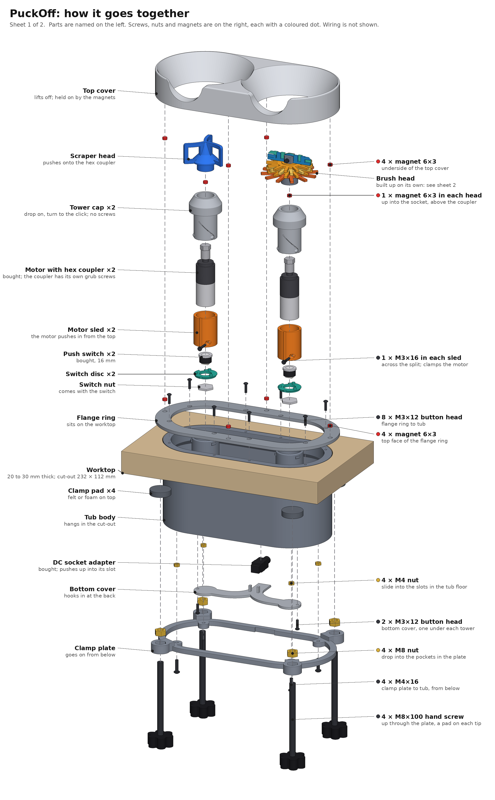
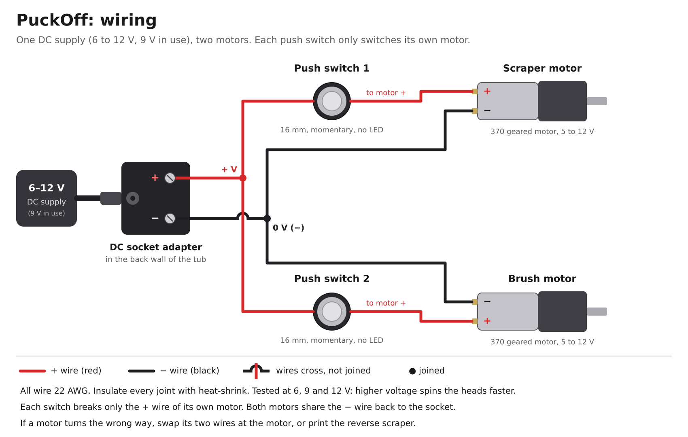

# Assembly

The exploded view shows where every part, screw, nut and magnet goes: [`images/exploded_view_1_whole_unit.png`](../images/exploded_view_1_whole_unit.png) and [`images/exploded_view_2_brush_head_and_hardware.png`](../images/exploded_view_2_brush_head_and_hardware.png), or both as a PDF in [`PuckOff_exploded_view.pdf`](PuckOff_exploded_view.pdf).

## Hardware

All from the Bambu Lab store (UK links; the same items are in the other regional stores). Pick the size on each page; the item code is shown next to each size.

| Item | Qty | Bambu store | Where it goes |
|---|---|---|---|
| M3×12 button head screw (BHCS) | 10 | [M3 BHCS](https://uk.store.bambulab.com/products/m3-button-head-cap-machine-screws-bhcs), size M3×12, AA059 | 8 hold the flange ring to the tub, 2 hold the bottom cover (one under each tower). Must be button head on the ring: a taller head stands proud and the top cover will not sit down. |
| M3×16 button head screw (BHCS) | 2 | [M3 BHCS](https://uk.store.bambulab.com/products/m3-button-head-cap-machine-screws-bhcs), size M3×16, AA060 | One across the split of each motor sled. A socket head M3×16 also fits. |
| M3×20 socket head screw (SHCS) | 1 | [M3 SHCS](https://uk.store.bambulab.com/products/m3-socket-head-cap-machine-screws-shcs-1), size M3×20, AA040 | Right across the brush spindle, through both combs. |
| M3 self-locking (nyloc) nut | 1 | [Self locking hex nut](https://uk.store.bambulab.com/products/self-locking-hex-nut), M3, AB008 | On the back of the brush spindle. A plain M3 nut also works. |
| M4×16 button head screw (BHCS) | 4 | [M4 BHCS](https://uk.store.bambulab.com/products/m4-button-head-cap-machine-screws-bhcs), size M4×16, AA067 | Clamp plate to tub, from below. Worktop fitting only. |
| M4 hex nut | 4 | Carbon steel hex nut, M4, in the [fasteners section](https://uk.store.bambulab.com/collections/fasteners) | Slide into the slots in the four bosses on the tub floor. Worktop fitting only. |
| Round magnet 6 × 3 mm | 10 | [Round magnet](https://uk.store.bambulab.com/products/round-magnet), D6×3 | 4 in the flange ring, 4 in the top cover, 1 in each head. |
| M8×100 hand screw (star knob) | 4 | not in the Bambu store | Up through the ears of the clamp plate. Worktop fitting only. |
| M8 nut | 4 | not in the Bambu store | Drop into the hex pockets in the clamp plate ears. Worktop fitting only. |

Also: felt or foam for the tops of the clamp pads (worktop fitting only).

The M3×12 and M3×16 screws cut their own thread in the printed holes, so no other nuts are needed.

## Bought parts

| Part | Qty | Link | Notes |
|---|---|---|---|
| 12 V geared motor, Mabuchi 370 with planetary gearbox, D-shaft | 2 | [AliExpress](https://www.aliexpress.com/item/1005004449521703.html) | Sold in several speeds (22 to 58 RPM). |
| Shaft coupler, 4 mm bore to 12 mm hex | 2 | [AliExpress](https://www.aliexpress.com/item/1005009791959118.html) | |
| Push switch, 16 mm, momentary, no LED, with wires, 12 to 24 V, black | 2 | [AliExpress](https://www.aliexpress.com/item/1005004920346156.html) | Pick the momentary, no-LED option. |
| 12 V power supply with DC plug | 1 | [Amazon UK](https://www.amazon.co.uk/dp/B096VPYQ69) | |
| DC socket adapter with screw terminals, 5.5 × 2.1 mm | 1 | | Pushes up into the slot in the back of the tub. Match it to the plug on your supply. |
| 22 AWG wire, red and black | | [Amazon UK](https://www.amazon.co.uk/dp/B07V5FVSYL) | |
| Heat-shrink sleeving | | | For every joint. |

## Wiring

From the + terminal of the DC socket, one red wire to each push switch, and from each switch on to the + of its own motor. The − of both motors goes back to the − terminal of the socket. Pressing a portafilter onto a head closes that motor's switch, so each motor only runs while its own head is pressed.

If a motor turns the wrong way, swap its two wires at the motor (see Direction below). Optional extras, not used in this build: an inline fuse in the + wire from the socket, and a diode across each motor (stripe to +) to save the switch contacts.

## Order of assembly

1. **Magnets.** 4 in the flange ring, 4 in the top cover, 1 in each head. Check that each ring and cover pair pulls together before pressing them home. A drop of superglue if one is loose.
2. **Motors.** Fit the coupler on each motor shaft. Solder the leads, push each motor into a sled from the top until it seats, and nip up its M3×16.
3. **Switches.** Fit each switch into its disc with its own nut. Lay the motor wires in the notch in the rim of the disc, then lower the disc and the sled down the tower together, wires first, with the groove on the rib.
4. **Tower caps.** Line the three slots up with the lugs, push down and turn clockwise until it clicks.
5. **Flange ring.** Slide the 4 M4 nuts into the bosses on the tub floor. Screw the flange ring to the tub with 8 × M3×12.
6. **Wiring and socket.** Wire up. Push the socket adapter up into its slot, hook the back edge of the bottom cover in at the back and fit its 2 × M3×12. Lower the tub into the worktop.
7. **Clamp, from below.** Clamp plate on with 4 × M4×16, M8 nuts in their pockets, hand screws up through, a pad on each tip, then wind them up against the worktop.
8. **Finish.** Top cover on its magnets, heads on.

For bench-top use in the grounds container, skip step 7 and drop the whole unit into the container with the power socket facing the hole in its back wall. Unplug before lifting the unit out to empty it.

## Brush head

From the bottom of the spindle up:

1. Magnet into the socket in the hub.
2. Rim star, boss up.
3. Wall star A, wall star B, wall star A, bosses up.
4. Both combs into the slot back to back, the second one turned half a turn.
5. M3×20 right across, with the nut on the back.

The combs must sit down on the top star with no gap. If there is a 4 mm gap, a wall star is missing.

## Worktop

- Worktop 20 to 30 mm thick.
- Cut-out 232 × 112 mm with rounded ends of 56 mm radius.
- The flange ring is 250 × 130 mm and overlaps the cut-out by 9 mm all round.
- The nose of the power socket stands 5 mm proud of the back of the tub, so the tub will not pass through the cut-out with it fitted. Either fit the socket and bottom cover from below once the tub is in, or cut a notch 14 mm wide and 6 mm deep in the middle of the back edge of the cut-out (the flange ring hides it).

## Direction

The tower caps lock by turning clockwise, so a head turning clockwise drags its cap onto its stop. If your motor turns the other way, swap its two wires, or print the reverse scraper and rely on the click to hold the cap.
